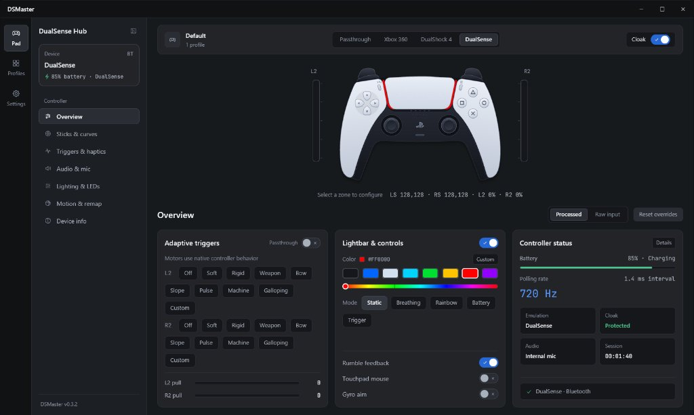

<h1 align="center">
  
  &nbsp;DSMaster
</h1>

<p align="center">
  Fast, lightweight Windows app for PlayStation 5 DualSense and DualSense Edge controllers — built in Rust with a GPU-accelerated <a href="https://gpui.rs">GPUI</a> interface.
</p>



## Features

- **USB & Bluetooth DualSense / DualSense Edge:** Plug-and-play support over USB or Bluetooth with live input monitoring, battery level, and hardware/firmware diagnostics.
- **Controller Emulation:** Emulate an **Xbox 360** or **DualShock 4** controller (via ViGEmBus), or a **Virtual DualSense** (via `usbip-win2`) so games get native adaptive triggers, lightbar RGB, player LEDs, and rumble even over Bluetooth.
- **Double-Input Protection:** Built-in **HidHide** cloaking hides your physical controller from games so you never get duplicate inputs.
- **Adaptive Triggers & Rumble:** Independent L2/R2 trigger presets (`Off`, `Soft`, `Rigid`, `Weapon`, `Bow`, `Slope`, `Pulse`, `Machine`, `Galloping`, `Custom`), custom force/position tuning, and rumble intensity scaling with live motor testing.
- **Lighting & LEDs:** Full RGB color picker, lightbar animations (`Static`, `Breathing`, `Rainbow`, `Battery`, `Trigger`), brightness control, player LEDs, mic mute LED override, low-battery red flash, and idle dim timer.
- **Bluetooth Audio, Mic & Audio-to-Haptics:** Stream PC audio to the controller's built-in speaker or 3.5 mm headphone jack over Bluetooth, use the controller's microphone as a Windows input device, and turn PC or controller audio into live HD haptics.
- **Sticks, Triggers, Remapping & Hotkeys:** Radial/Axial deadzones, anti-deadzone, outer deadzone, response curves, hair-triggers, full button-to-button remapping, Turbo rapid-fire, and **keyboard hotkeys, media keys, and multi-step macros** (e.g. bind the controller's Mic button to mute Discord).
- **Touchpad Mouse, Gyro Aim & Flick Stick:** Use the touchpad as a desktop mouse (2-finger scroll, tap-to-click, split L/R click), aim with calibrated gyro (mouse or right stick), and snap-turn with **Flick Stick**.
- **Emulator & Mod Support:** Built-in **CemuHook / DSU** motion server (port `26760`) for Cemu, Dolphin, Ryujinx, and RPCS3, plus a **DSX-compatible UDP mod server** (port `6969`) for game mods that drive adaptive triggers and LEDs.
- **Per-App Profiles & Desktop Quality of Life:** Automatic profile switching per game, TOML export/import, live battery icon in the system tray, desktop notifications (connect, disconnect, low battery), optional Bluetooth idle auto-disconnect, launch at startup, and built-in GitHub Releases auto-updater.

## Requirements

- Windows 10 or Windows 11 (x64)
- [Nefarius ViGEmBus](https://github.com/nefarius/ViGEmBus/releases) driver for Xbox 360 and DualShock 4 emulation
- [Nefarius HidHide](https://github.com/nefarius/HidHide/releases) driver (optional) for hiding the physical controller
- [vadimgrn/usbip-win2](https://github.com/vadimgrn/usbip-win2/releases) (BSD-2-Clause, optional) for Virtual DualSense emulation. *Anti-cheat note:* Virtual USB/IP emulation is intended for single-player and native-DualSense PC titles; switch DSMaster to **Passthrough** mode (and avoid running `usbip-win2`) when playing competitive titles with strict kernel anti-cheat (e.g., FACEIT, Vanguard, Ricochet).

## Building

### MSVC (with Windows 11 SDK)

```powershell
cargo build --release
```

### MinGW / GNU (`x86_64-pc-windows-gnu`)

```powershell
cargo build --profile gui
```

Run unit tests:

```powershell
cargo test
```

## Architecture

- `src/protocol/` — Zero-allocation DualSense USB/Bluetooth report parser & encoder, output parser/encoder, IMU calibration, adaptive trigger payloads, synthetic feature reports (`0x05`, `0x09`, `0x20`), and clean-room USB/HID descriptors.
- `src/hid/` — Overlapped Win32 HID transport, 3-layer virtual-device self-exclusion, PnP device arrival/removal monitor, and Bluetooth power disconnect (`IOCTL_BTH_DISCONNECT_DEVICE`).
- `src/emu/` — DualSense-to-XUSB/DS4 mapping, pure-Rust `ViGEmBus` IOCTL client, and clean-room USB/IP v1.1.1 Virtual DualSense & UAC audio backend (`usbip-win2`).
- `src/cloak/` — Direct `HidHide` IOCTL client, virtual-device safety guards, and NT path translation.
- `src/engine/` — MMCSS `"Games"` per-controller I/O loop, input processing, mouse/Flick Stick & keyboard/macro injection, CemuHook DSU & DSX UDP servers, `ArcSwap` profiles, foreground app watcher, and wait-free `SeqLock` telemetry.
- `src/tray.rs`, `src/startup.rs`, `src/drivers.rs`, `src/updater.rs` — Dynamic battery system tray & notifications, single-instance guard, Windows startup registration, driver installer, and GitHub Releases updater.
- `src/ui/` — GPUI interface (`theme`, `widgets`, `icons`, `controller_view`, `DsMasterView`).

## Disclaimer

DSMaster is an independent, clean-room open-source project and is not affiliated with, endorsed by, or sponsored by Sony Interactive Entertainment LLC, Microsoft Corporation, or Valve Corporation. PlayStation, DualSense, DualShock, and Xbox are trademarks of their respective owners, used strictly for interoperability identification.

## License

Licensed under the [MIT License](LICENSE).
